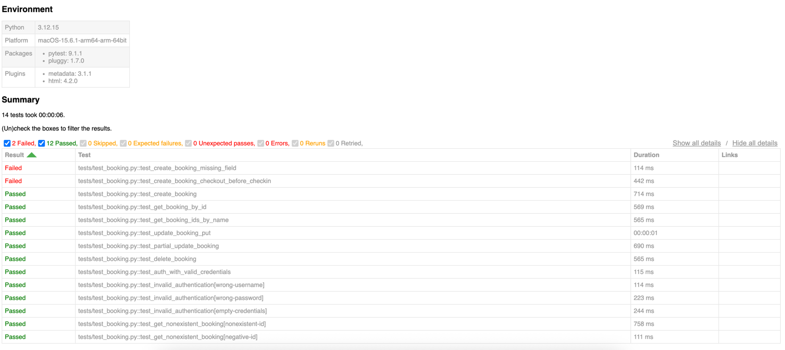

# Restful-Booker API Test Automation

A focused Python 3.12 API test suite for [Restful-Booker](https://restful-booker.herokuapp.com), built with **pytest**, **requests**, and **uv**.

The suite prioritizes meaningful booking lifecycle coverage, authenticated operations, selected negative scenarios, and reliable test isolation over a large framework.

## Prerequisites

- Python 3.12
- [uv](https://docs.astral.sh/uv/)
- Git
- Network access to the public Restful-Booker API

## Setup

1. Clone the repository and enter the project directory, then install the locked dependencies:

```bash
git clone https://github.com/OksanaPR/restful-booker-api-tests.git
```

2. Install Dependencies

Install the project dependencies using uv:

```bash
uv sync --frozen
```
This creates a virtual environment (if needed) and installs dependencies defined in pyproject.toml and locked in uv.lock.
No manual virtual environment activation is required when using uv run.

3. Configure Environment Variables

The tests use the public [Restful-Booker](https://restful-booker.herokuapp.com) API by default:

Set the credentials required for authenticated API operations:
Get username and password from the official documentation - [username](https://restful-booker.herokuapp.com/apidoc/index.html#api-Auth), [password](https://restful-booker.herokuapp.com/apidoc/index.html#api-Auth)

```bash
macOS / Linux:
export API_USERNAME=username
export API_PASSWORD=password
```

Windows (PowerShell):
```bash
$env:API_USERNAME=username
$env:API_PASSWORD=password
```

The suite reads these values through `os.environ`. **Do not commit credentials for private environments.** In CI, supply them through secret/variable configuration. 


## Running tests

 Switch to cloned repo

```bash
uv run pytest                # Run the complete test suite
uv run pytest -v  # Run tests with detailed output
uv run pytest tests/test_booking.py -v     # Run a specific test file
uv run pytest -k test_create_booking -v # Run a specific test by name
uv run pytest -v -ra --tb=short              # Run tests with a concise failure summary
```

**Test Execution Notes**

- Tests run against the public Restful-Booker API. 
- Test data is generated independently using pytest fixtures and unique identifiers. 
- Created bookings are cleaned up where possible using fixture teardown. 
- Authenticated operations use tokens obtained through the /auth endpoint. 
- The public API is shared and periodically reset, so transient failures or unexpected data changes may occur. 
- Cleanup: the framework verifies a unique marker before deleting an existing booking.

### 6. Code Quality

This project uses [Ruff](https://docs.astral.sh/ruff/), a fast Python linter and formatter, to maintain consistent coding standards and catch potential issues early.

Ruff helps to:
- Detect unused imports, undefined variables, and other common code-quality issues.
- Enforce consistent code formatting across the project.
- Improve code readability and maintainability.
- Reduce unnecessary style-related changes during code reviews.
- Enable automated quality checks in a future CI pipeline.

**Run static code analysis:**

```bash
uv run ruff check .
```

**Verify formatting without modifying files:**

```bash
uv run ruff format --check .
```

**Automatically format Python files:**

```bash
uv run ruff format .
```

## Test Coverage and Prioritization

The suite has **11 test functions (14 cases with parametrization)** in `tests/test_booking.py`, grouped by the three areas of the assignment: booking lifecycle, authentication, and input validation.

I prioritized the core booking flow, checking that changes are really saved (not only the HTTP response), and a few negative cases with the highest risk of bad data. The goal was meaningful coverage within the timebox, not testing every endpoint and input combination.

**Documented vs. assumed behavior:** the [API documentation](https://restful-booker.herokuapp.com/apidoc/index.html) describes only success responses (`200 OK`, and `201 Created` for DELETE and `/ping`). It does not define any error codes. So every 4xx expectation in this suite is an **assumption** (standard HTTP behavior) or a **proposed requirement** (based on the documented required fields and types), and is labeled that way in the test comments.

### 1. Booking Lifecycle

| Test | What it checks | Why I added it |
|---|---|---|
| `test_create_booking`| POST returns a numeric `bookingid` and echoes the submitted data | Creating a booking is the core operation; every other test depends on it |
| `test_get_booking_by_id`| GET returns exactly the data that was submitted | Proves the data was stored, not only returned by POST |
| `test_get_booking_ids_by_name`| Filtering by first and last name returns the created booking | Covers a documented query feature; the unique first name makes it reliable on a shared instance |
| `test_update_booking_put`| Full update with a valid token; the response and a fresh GET show the new data | Verifies a full update is applied **and saved** |
| `test_partial_update_booking`| PATCH changes one field; the other fields stay the same, confirmed with GET | Partial updates can accidentally overwrite unchanged fields |
| `test_delete_booking`| DELETE returns `201` (documented); a following GET returns `404` (assumption) | Verifies deletion is observable, not only acknowledged |

### 2. Authentication

| Test | What it checks | Why I added it |
|---|---|---|
| `test_auth_with_valid_credentials`| `/auth` returns a non-empty token for the documented demo credentials | All write operations depend on this token |
| `test_invalid_authentication[wrong-username, wrong-password, empty-credentials]`| No token is returned for invalid credentials | Makes sure a token is never issued for bad credentials |
| `test_update_booking_put`, `test_partial_update_booking`, `test_delete_booking`| Authenticated PUT, PATCH and DELETE succeed with a valid token | Exercises the documented authenticated write operations |

Note: for invalid credentials the API returns `200` with `{"reason": "Bad credentials"}` instead of `401`. The documentation does not define this case, so the test records the current behavior rather than treating it as a defect.

### 3. Input Validation and Negative Behavior

| Test | Scenario | Expected | Basis | Why I added it |
|---|---|---|---|---|
| `test_get_nonexistent_booking[nonexistent-id, negative-id]`| GET an ID that does not exist, and a negative ID | `404` | Assumption | Clients must get a clear "not found", not an error or someone else's data |
| `test_create_booking_missing_field`| POST without the required `firstname` | `400` | Proposed requirement (field is documented as required) | Missing required data is the most common client mistake |
| `test_create_booking_checkout_before_checkin`| POST with checkout before checkin | `400` | Proposed requirement | Invalid date ranges create corrupt bookings |

The last two tests currently fail because of API defects (see Findings): a missing field returns `500 Internal Server Error`, and checkout before checkin is accepted and stored. If the API creates the invalid booking anyway, the test registers it for cleanup.

---

## Findings

Reproduction steps for each finding can be found in [docs/findings.md](docs/findings.md).
1. BUG 1 - Create booking returns 500 instead of 400 when the required firstname field is missing
2. BUG 2 - Create accepts checkout date earlier than check-in date

## Future Tests and Improvements

Tests I would add next, in priority order:

| Priority | Area | Test | Reason |
|---|---|---|---|
| 1 | Authentication | PUT, PATCH and DELETE with a missing or invalid token, then GET to confirm the booking is unchanged | Unauthorized writes are the main security risk |
| 2 | Authentication | PUT and DELETE with Basic auth (`Authorization` header) | Documented alternative to the token cookie |
| 3 | Input validation | Wrong field types, e.g. `totalprice: "abc"` on POST and PATCH | Currently stored as `null` silently, which is data loss |
| 4 | Input validation | Malformed dates, e.g. `checkin: "not-a-date"` | Currently stored as `"0NaN-aN-aN"` |
| 5 | Input validation | Missing `bookingdates`, empty `firstname` or `lastname`, negative `totalprice` | Boundary values for required fields |
| 6 | Not found | PUT, PATCH and DELETE on a booking that does not exist | Currently returns `405` instead of `404` |
| 7 | Filtering | Filter by checkin and checkout dates; a filter with no matches returns an empty list | Remaining documented query parameters |
| 8 | Content types | XML request and response (`Accept: application/xml`) | Documented, but not covered |

### Further Improvements

- Mark known defects with `pytest.mark.xfail(reason="BUG n: ...")`, so a run separates known bugs from new failures.
- Add JSON Schema checks for response structure alongside the value assertions.
- Add the Ruff checks to the CI workflow and run the workflow on pull requests.
- Separate fast smoke tests from the full suite using pytest markers.

## CI Integration — GitHub Actions

The test suite is integrated with GitHub Actions to demonstrate automated execution in a CI environment.

**Workflow:** `.github/workflows/api-tests.yml`

### Execution

The workflow can be triggered manually from the GitHub Actions tab using **Run workflow**.

It performs the following steps:

1. Checks out the repository.
2. Sets up Python 3.12 and installs dependencies using `uv`.
3. Executes the pytest API test suite.
4. Generates a JUnit XML report and uploads it as a GitHub Actions artifact.

Ruff checks are run locally (see Code Quality) and are not part of the workflow.

### Configuration

The workflow uses the following environment variables:

| Variable | Configuration |
|---|---|
| `BASE_URL` | Public Restful-Booker API URL |
| `API_USERNAME` | GitHub Actions repository secret |
| `API_PASSWORD` | GitHub Actions repository secret |

Credentials are injected at runtime and are not stored in the source code.

### Execution Results

- Local run


- **GitHub Actions run:** [View test execution](REPLACE_WITH_ACTUAL_RUN_URL)
- **Result:** To be recorded after execution
- **Test report:** `pytest-results` artifact containing `results.xml`

The execution report includes test statuses, execution times, and failure information. GitHub Actions job logs provide additional debugging details.

Sensitive values such as credentials and authentication tokens should not be logged.

### Limitations

The suite runs against a shared public API, which may be reset or modified by other users. As a result, some failures may be related to environmental instability rather than application regressions.

In a production project, I would use an isolated test environment and extend this workflow to run automatically on pull requests.

