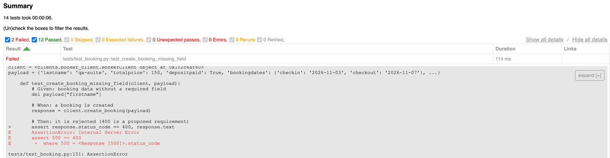
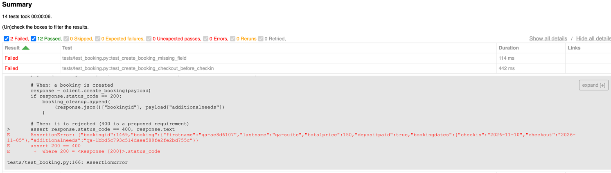

BUG 1 - Create booking returns 500 instead of 400 when the required firstname field is missing

**Steps to Reproduce**
1. Prepare a valid booking payload
2. Remove the firstname field
3. Send a POST /booking request

*Example request body:*

{
  "lastname": "qa-suite",
  "totalprice": 150,
  "depositpaid": true,
  "bookingdates": {
    "checkin": "2026-11-03",
    "checkout": "2026-11-07"
  },
  "additionalneeds": "qa-test-marker"
}

**Actual Result**

The API responds with:
HTTP/1.1 500 Internal Server Error

Test: tests/test_booking.py::test_create_booking_missing_field
Assertion: assert 500 == 400
Location: tests/test_booking.py:151

**Expected Result**

The API rejects the request with HTTP 400 Bad Request and a descriptive validation message indicating that firstname is required.

BUG 2 - Create accepts checkout date earlier than check-in date

**Steps to Reproduce**
1. Prepare a valid booking payload
2. Set checkin to 2026-11-10
3. Set checkout to 2026-11-05
4. Send a POST /booking request

*Example request body:*
{
  "firstname": "qa-test",
  "lastname": "qa-suite",
  "totalprice": 150,
  "depositpaid": true,
  "bookingdates": {
    "checkin": "2026-11-10",
    "checkout": "2026-11-05"
  },
  "additionalneeds": "qa-test-marker"
}

**Actual Result:**
The API returns HTTP 200 OK and creates the booking successfully.

Test: tests/test_booking.py::test_create_booking_checkout_before_checkin
Assertion: assert 200 == 400
Location: tests/test_booking.py:166

**Expected Result**

The API rejects the request with HTTP 400 Bad Request and a validation message explaining that checkout must be later than check-in.
